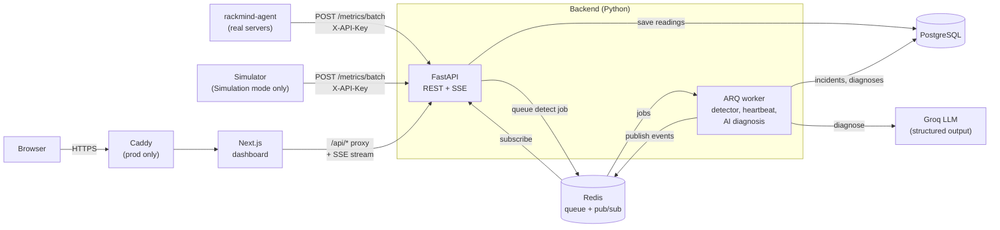

# Rackmind

**AI-assisted data center monitoring and incident management.**

Rackmind watches real Linux servers through a small agent, or a simulated data center you can switch to at any time to explore it. It notices when a server starts misbehaving or goes silent, opens an incident, and asks an LLM for a probable cause and next steps, while people stay in charge of every decision.

<!-- CI badge, once the repo is on GitHub:
[](https://github.com/<user>/rackmind/actions/workflows/ci.yml)
-->

<!-- Demo: add a screenshot or GIF here, e.g. docs/demo.gif, and link the 2-minute video. -->
> 📽️ **Demo video:** _coming soon_  ·  🌐 **Live demo:** _coming soon_

---

## What it does

- **Live and Simulation modes.** A switch in the header shows either your real servers, or a simulated data center of four racks × five servers. The simulator only runs while someone is in Simulation mode, and replays a scripted demo (first incident within a minute) each time.
- **Real servers.** A one-file Python agent sends CPU usage, memory, disk, network (and temperature when there is a sensor) every 5 seconds. Each server has its own charts with selectable time ranges.
- **Silent server detection.** A heartbeat job opens a critical "not reporting" incident when a real server stops sending, and the AI judges its last minutes before the silence.
- **Anomaly detection.** A background worker checks every batch of readings against fixed safety limits *and* each server's own recent normal (a rolling z-score), and opens **one** incident per affected server, never duplicates.
- **Incident workflow.** Incidents go `open → acknowledged → resolved`, with assignment, comments, a full audit history, and a "looks recovered" hint when readings return to normal. Nothing is ever closed automatically.
- **AI diagnosis.** Each new incident gets a structured diagnosis from an LLM: probable cause, confidence, recommended steps and the evidence behind them. The answer is schema-validated before anyone sees it; the AI **only suggests** and never acts on infrastructure.
- **Real-time updates.** New incidents, status changes and diagnoses appear in every open browser instantly (Server-Sent Events over Redis pub/sub), with a "New incident" toast.
- **Role-based access.** Operators, engineers and admins see and can do different things. The API enforces every rule; the UI just hides what you can't use.
- **Fault injection.** The simulator can spike a CPU, overheat a rack, fill a disk or leak memory on a schedule, so the whole pipeline can be demonstrated end to end.

## Architecture



**The flow, step by step**

1. Each **agent** sends its server's reading every 5 s to `POST /metrics/batch`, authenticated with a machine API key. In Simulation mode, the **simulator** does the same for 20 simulated servers.
2. The **API** validates them (Pydantic), writes them in one `INSERT`, queues a `detect_anomalies` job in Redis, and responds immediately. Ingestion never waits on detection.
3. The **worker** runs the detector. If a server looks wrong, it opens an incident (or raises the severity of the existing one) and queues a diagnosis job. Every 30 s it also checks that each real server reported recently.
4. The worker builds a compact context (metrics around the incident, rack neighbours, similar past incidents), calls the **LLM** with a strict JSON schema, validates the answer again, and stores it, or stores *why* it failed.
5. Every change is published on Redis; each open **`/stream`** connection forwards it to the browser, which refetches what changed.

## Tech stack

| Layer | Choice |
|---|---|
| Backend | FastAPI (Python 3.12, fully async), Pydantic v2 |
| Database | PostgreSQL 17, SQLAlchemy 2.0 (async) + Alembic migrations |
| Background jobs | Redis + ARQ |
| Real-time | Server-Sent Events, Redis pub/sub |
| Auth | JWT in an `HttpOnly` cookie, Argon2 password hashes, role-based access control |
| AI | Groq API (`openai/gpt-oss-120b` by default), strict structured outputs, validated with Pydantic |
| Frontend | Next.js 16 (App Router, Cache Components), TypeScript, Tailwind CSS v4, SWR, Recharts |
| Quality | pytest + httpx, ruff, mypy (strict), eslint, prettier |
| Infra | Docker Compose, Caddy (automatic HTTPS), GitHub Actions |

## Quick start

You need **Docker** (with Compose). Then, from the repo root:

```bash
cp .env.example .env
docker compose up --build
```

That starts Postgres, Redis, the API, the worker, the simulator and the dashboard, applies migrations and seeds demo data.

- Dashboard: **http://localhost:3000**
- API docs (Swagger): **http://localhost:8000/docs**

**Demo accounts** (password = `SEED_PASSWORD` in `.env`, `change-me` by default):

| Email | Role |
|---|---|
| `operator@rackmind.local` | operator |
| `engineer@rackmind.local` | engineer |
| `admin@rackmind.local` | admin |

**See an incident happen.** With no real server connected, the dashboard opens in **Simulation mode** (or pick it in the header, or open `/?mode=simulation`). That starts the simulator and its demo scenario (`SIM_FAULTS`): `r02-srv03` gets a CPU spike (a critical incident within about a minute), then `r03-srv02` leaks memory, rack R04 overheats and `r01-srv03` fills its disk. Switching back to Live stops it; switching again replays the scenario.

**Connect a real server.** Register it with `docker compose exec api python -m app.add_server web-01 --group Production`, then run [`agent/rackmind_agent.py`](agent/rackmind_agent.py) on the machine with the id it prints. It needs Python 3.12+ and three settings: `RACKMIND_URL` (`https://<domain>/api` in production, `http://<host>:8000` in dev), `RACKMIND_KEY` (the `INGEST_API_KEY`) and `RACKMIND_SERVER_ID`. To run it as a service on Linux:

```bash
sudo mkdir -p /opt/rackmind-agent && sudo cp agent/rackmind_agent.py /opt/rackmind-agent/
sudo python3 -m venv /opt/rackmind-agent/venv
sudo /opt/rackmind-agent/venv/bin/pip install httpx psutil
sudo nano /etc/rackmind-agent.env      # the three RACKMIND_* lines
sudo chmod 600 /etc/rackmind-agent.env # the key is a secret
sudo cp agent/rackmind-agent.service /etc/systemd/system/
sudo systemctl daemon-reload && sudo systemctl enable --now rackmind-agent
```

**AI diagnosis is optional.** Put a free key from [console.groq.com](https://console.groq.com/keys) in `GROQ_API_KEY`. Without one, everything else works, and incidents say the AI is not configured.

## Roles

| | Operator | Engineer | Admin |
|---|:-:|:-:|:-:|
| View dashboard, servers, incidents | ✅ | ✅ | ✅ |
| Acknowledge and comment | ✅ | ✅ | ✅ |
| Resolve and assign incidents | | ✅ | ✅ |
| Read, retry and rate AI diagnoses | | ✅ | ✅ |
| Manage users | | | ✅ |

## How the interesting parts work

### Anomaly detection
The detector (`api/app/services/detector.py`) is a set of pure functions, easy to test without a database. For each metric it compares the **mean of the last 30 s** (to smooth out noise) against two rules and keeps the more severe result:

- **Fixed thresholds**: dangerous on any server (e.g. CPU ≥ 70 °C warning, ≥ 80 °C critical; CPU usage ≥ 90 % / ≥ 98 %; disk/memory ≥ 85 % / ≥ 95 %). Metrics a server doesn't report (most VPSes have no temperature sensor) are skipped.
- **Rolling z-score**: how far the recent mean is from *this server's* baseline (its readings from 30 to 5 minutes ago). The 5-minute gap keeps a slow drift from hiding inside its own baseline; a per-metric floor on the standard deviation stops perfectly steady metrics from turning tiny wobbles into alarms; only *upward* deviations count, so recovery doesn't trigger a false alarm.

**No duplicates:** a partial unique index in Postgres allows at most one active incident per server, and inserts use `ON CONFLICT DO NOTHING`, so two concurrent jobs can't both open one. New findings only raise an incident's severity, never lower it.

**Silent servers:** detection runs when readings arrive, so it can't notice a server that stopped sending. A cron job in the worker (every 30 s) turns "no reading for 60 s" into a critical finding that goes through the same incident rules; when readings come back, the incident is marked "looks recovered".

### Simulation mode
The simulator only runs while someone is in Simulation mode. Browsers in that mode refresh a Redis key with a 90 s expiry every 30 s; the simulator checks it before each cycle and sleeps while it is gone. Closing the tab needs no cleanup: the key just expires. Every list the dashboard shows is filtered by `?source=agent` or `?source=simulated`, so demo data never mixes with real servers.
### AI diagnosis, safely
- **Context, not raw data.** About 1,800 raw readings are summarised into per-minute averages plus baseline statistics (~3.5k characters), along with rack neighbours (shared cause, or one machine?), the detector's reasons, and up to five similar resolved incidents with their comments.
- **Two layers of validation.** The JSON Schema of the response model is sent to Groq in strict mode, then Pydantic validates the answer again before it is stored. Malformed output is stored as `invalid_output` and never shown.
- **Graceful failure.** Timeouts, rate limits and API errors are retried with backoff, then stored as a named failure state. The incident works the same either way, and an engineer can ask again.
- **Suggest, never act.** No code path touches infrastructure. Risky steps must start with "Requires approval:", the UI labels the panel as AI-generated, and human-written text (titles, comments) is passed as data, never instructions, to resist prompt injection.

### Real-time
The API and worker publish `{action, incident}` on a Redis channel after each commit. `GET /stream` is a Server-Sent Events endpoint: it checks the session, **releases its database connection** (the request may stay open for hours), then forwards each message. The browser keeps one `EventSource` for the whole app and asks SWR to refetch only the incident data that changed.

### Auth
Login sets a signed JWT in an `HttpOnly`, `SameSite=Lax` cookie (`Secure` in production). The token holds only the user id; the role is read from the database on every request, so a role change or deactivation applies immediately. The browser only ever talks to the Next.js origin, which proxies `/api/*` to FastAPI: no CORS, and cookies just work.

## Decisions and trade-offs

| Decision | Why | Trade-off |
|---|---|---|
| **Async FastAPI** | Most work is waiting on Postgres, Redis or the LLM; async serves many of those at once on one process. | Every library on the request path must be async-aware (asyncpg, async SQLAlchemy). |
| **Detection in a worker, not in the request** | Ingestion stays fast and keeps working if detection is slow or broken. | Incidents appear a moment after the data, and a queue (Redis) is one more moving part. |
| **Thresholds + z-score** instead of ML | Explainable ("72 °C, 6σ above this server's normal"), no training data needed, easy to test. | The z-score slowly accepts long anomalies as normal, and assumes roughly Gaussian noise. |
| **SSE** instead of WebSockets | Updates only flow server → browser; SSE is plain HTTP, sends cookies, reconnects on its own. | One-way only; each tab holds an open connection. |
| **JWT in an HttpOnly cookie** | Scripts (including injected ones) can't read it; no token handling in the frontend. | Logout can't revoke a copied token before it expires (no server-side session list). |
| **Permissions enforced in the API** | The UI can be bypassed; the API can't. One permission matrix test covers every role × endpoint. | Rules are mirrored in the frontend just to hide buttons, so both must stay in sync. |
| **LLM output in a strict schema** | The UI can rely on its shape, and bad output fails loudly instead of rendering nonsense. | Fewer models support strict structured outputs; the model is configurable via `GROQ_MODEL`. |
| **Plain PostgreSQL** for metrics | One database to run and back up; a `(server_id, timestamp)` index covers every query here. | No automatic downsampling or retention; TimescaleDB would be the next step at real volumes. |

## Limits

- **The agent is deliberately minimal.** Agents share the simulator's API key (any agent could post for any server), readings are not buffered while the API is down, and installation is manual. Per-server revocable tokens, buffering and an install script are the production next steps.
- **No retention yet.** Raw readings are kept forever; real volumes would need retention and downsampling.
- A rack-wide fault opens one incident **per server**; nothing correlates them into one rack-level incident yet.
- The AI only sees metrics, not logs or hardware events, so its causes stay fairly generic. Its confidence is the model's own estimate, not a measured probability.
- Each new incident costs one LLM call.

## Testing and CI

```bash
docker compose exec api pytest          # 226 tests: detector, heartbeat, deduplication, incident
                                        # lifecycle, permission matrix, simulation lease, AI failure
                                        # handling (mocked LLM), SSE…
docker compose exec simulator pytest    # fault math, pause/resume
cd agent && pip install -e ".[dev]" && pytest   # network rate, payload shape
docker compose exec api ruff check . && docker compose exec api mypy
cd web && npm run lint && npm run typecheck
```

Backend tests run against a separate `<db>_test` database, and each test is rolled back, so dev data is never touched. The LLM is replaced by a fake client: no network, no cost.

**GitHub Actions** ([`.github/workflows/ci.yml`](.github/workflows/ci.yml)) runs lint, format check, type-check and tests for the API (against a real Postgres), the simulator, the agent and the web app (including a production `next build`) on every push.

## Deployment

```bash
cp .env.example .env    # real secrets, plus DOMAIN=your.domain
docker compose -f docker-compose.prod.yml up -d --build
```

The production stack builds slim, non-root images without hot reload, keeps Postgres/Redis/API private to the Docker network, and puts **Caddy** in front for automatic HTTPS.

## Project structure

```
api/              FastAPI app, worker, migrations, tests
  app/routers/    HTTP endpoints (metrics, racks, servers, incidents, auth, users, stream,
                  diagnosis, simulation)
  app/services/   business logic: detector, heartbeat, incidents, events, diagnosis, simulation
  app/ai/         LLM client, prompt, context builder, response schema
  app/workers/    ARQ worker (detection + diagnosis jobs, heartbeat cron)
  app/add_server.py  CLI to register a real server
web/              Next.js dashboard
simulator/        telemetry generator with fault injection (Simulation mode)
agent/            rackmind-agent: one-file metrics sender for real Linux servers
docker-compose.yml        local development (hot reload)
docker-compose.prod.yml   production (Caddy + HTTPS)
```

## Roadmap

- Per-server agent tokens (hashed, revocable), agent buffering and an install script
- Group related incidents (e.g. a rack-wide overheat) into one parent incident
- Editable detection rules per server or metric from the UI
- Metric retention and downsampling (TimescaleDB continuous aggregates)
- Feed logs and hardware events into the AI context
- Notifications (email / Slack) for critical incidents
- Server-side session revocation
