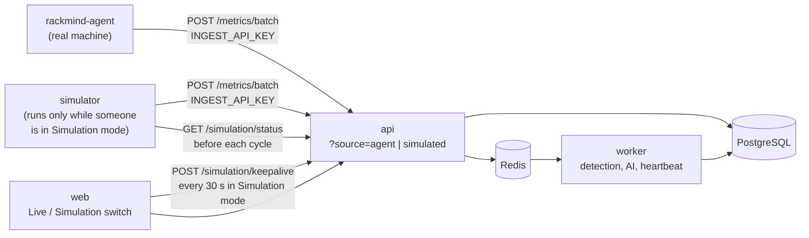

# RackMind v2 (lite): Real Servers and a Simulation Mode

> Let RackMind watch **real Linux machines**, and keep the 20 simulated servers as a **Simulation mode** the user can switch to at any time to explore the product.
> Continues [RACKMIND_PLAN.md](RACKMIND_PLAN.md) (phases 1-7 are done). Phases here start at 8.

---

## 1. Goal

**Today:** the simulator invents readings for 20 fake servers. Everything downstream (detection, incidents, AI diagnosis, live updates) already works and doesn't care where readings come from.

**Target:**
- A small agent script runs on real machines (a VPS, a laptop, a Raspberry Pi) and posts readings to the same endpoint. A machine that goes silent opens an incident.
- The UI has two modes, switched from the header:
  - **Live:** only real servers and their incidents.
  - **Simulation:** only the simulated data center, presented as a guided playground ("this is demo data, here's what to look at"). The simulator **starts when a user switches to Simulation mode** and stops when nobody is using it anymore.

**Why only this much:** RackMind is a portfolio project. v1 already shows the interesting engineering. v2 adds the claim worth making ("it monitors real servers"), the one new piece of design worth showing (detecting a silent server), and a clean way to demo everything without a real machine.

**What stays the same:**
- `POST /metrics/batch` is still the single entry point, protected by the shared `INGEST_API_KEY`.
- The queue, worker, incidents, AI diagnosis, SSE, auth and roles are unchanged.
- The simulator's readings and fault logic are unchanged; it just waits until Simulation mode is active.

---

## 2. Architecture

**How the switch works:**

1. The user switches to Simulation mode. The web app calls `POST /simulation/keepalive`, which sets a Redis key `simulation:active` that expires after 90 s.
2. While the user stays in Simulation mode, the web app repeats that call every 30 s, which keeps the key alive.
3. Before each cycle, the simulator asks `GET /simulation/status`. If the key exists, it sends readings and runs faults; if not, it sleeps.
4. When the user switches back to Live, closes the tab or loses connection, the keepalives stop, the key expires, and the simulator goes idle within about 90 s. Switching back to Live also calls `DELETE /simulation/keepalive` so it stops right away when that user was the only one.

If several users are in Simulation mode at once, they share the same simulated data center; it runs as long as at least one of them is there. Real servers are never affected.

| Mode | Shows | Simulator | When empty |
|---|---|---|---|
| **Live** | `agent` servers, their incidents and diagnoses | Idle (unless another user is in Simulation mode) | "No real servers connected yet." Links to the agent guide and to Simulation mode |
| **Simulation** | The 20 `simulated` servers, their faults, incidents and diagnoses, with a "Simulation mode: demo data" banner | Running | Never empty once the first readings arrive (a few seconds) |

---

## 3. Key Decisions

| Decision | Choice | Why |
|---|---|---|
| Telling servers apart | New column `servers.source`: `simulated` or `agent` | One field drives the mode filter, the badges and the heartbeat |
| What the switch controls | What the user sees **and** whether the simulator runs | The simulation exists to be explored; when nobody is watching it would only fill the database and spend AI calls on demo incidents |
| How the simulator knows to run | A Redis key with a 90 s expiry, refreshed by keepalives from browsers in Simulation mode | Stops by itself when tabs close or crash; no "who is watching" bookkeeping; works for several users at once |
| Who can start it | Any logged-in user, including viewers | Exploring the demo is read-only; it never touches real servers |
| Simulated data when idle | Kept, with the last readings | History survives; open simulated incidents stay as they were until the simulation resumes |
| Faults on start | First fault within ~1 minute of the simulation starting | A tutorial should show an incident quickly, not after a long wait |
| Where the mode is remembered | `localStorage` in the browser, also readable from the URL (`?mode=simulation`) | No backend state; a shareable demo link opens straight in Simulation mode |
| Default mode | Live if at least one `agent` server exists, otherwise Simulation | A fresh install opens on something to look at instead of an empty page |
| Filtering | Read endpoints (racks, servers, latest metrics, incidents) accept `?source=`; the client keeps only live events for its mode's servers | One query parameter, no duplicate endpoints |
| Agent authentication | Reuse the shared `INGEST_API_KEY` | Per-server tokens add CRUD, hashing and UI with little to show. Noted as a known limitation. |
| Adding a real server | CLI command `python -m app.add_server <name> --group <rack>` prints the `server_id` | No admin UI needed |
| Metrics | `cpu_temp` and `power_w` become optional; add `cpu_usage_pct` | VPSes have no temperature or power sensors; CPU usage is what matters there |
| Agent | One Python file using `psutil`, run with `python agent.py` (optionally under systemd) | No packaging or install script |
| Server goes silent | ARQ cron job every 30 s opens a "Not reporting" incident for `agent` servers | Detection only runs when data arrives, so a dead server would never alert |
| Last seen | Computed from the latest reading's timestamp | No extra column to keep in sync |

---

## 4. Phases and Checklists

Section 4 of [RACKMIND_PLAN.md](RACKMIND_PLAN.md) still applies (teaching mode, tests for business logic, a `docs/modules/` note, a commit per phase). Every migration must keep existing data, and `docker compose up` must still show the 20 simulated servers, faults and incidents after each phase.

### Phase 8: Metrics that fit real servers

- [x] Migration: `cpu_temp` and `power_w` nullable; add `cpu_usage_pct` (nullable for old rows); add `servers.source` (existing rows set to `simulated`)
- [x] `MetricIn` schema: temperature and power optional; `cpu_usage_pct` 0-100, optional
- [x] Simulator: also send `cpu_usage_pct` (rises during the overheat fault)
- [x] Detector: skip metrics with no value; thresholds for `cpu_usage_pct` (owner writes them, e.g. 90 % / 98 %)
- [x] AI context: leave out metrics a server doesn't report
- [x] UI: charts handle missing metrics; rack grid colors servers by CPU usage when they have no temperature
- [x] Tests: ingestion with and without optional fields, detector with missing metrics
- [x] Update `docs/modules/detection.md`

**Done when:** a reading without temperature and power is accepted, charted and checked by the detector.

---

### Phase 9: Live / Simulation switch

- [x] API: `?source=agent|simulated` filter on the racks, servers and incidents endpoints (no filter = everything, as today)
- [x] API: include `source` in server responses
- [x] API: `POST /simulation/keepalive` and `DELETE /simulation/keepalive` (any logged-in user) set or clear the Redis key `simulation:active` (90 s expiry)
- [x] API: `GET /simulation/status` (logged-in users and the simulator's key) returns `{active: bool}`
- [x] Simulator: check the status before each cycle; sleep while inactive; log "simulation started / paused"
- [x] Simulator: on start, schedule the first fault within ~1 minute
- [x] Web: mode switch in the header; mode kept in `localStorage` and `?mode=`; default as in section 3
- [x] Web: in Simulation mode, send a keepalive on entry and every 30 s; send the `DELETE` when switching to Live
- [x] Web: every page (dashboard, incidents, server detail) reads the mode and passes `source`; the new-incident toast ignores the other mode's servers
- [x] Web: "Starting simulation…" state until the first readings arrive
- [x] Web: Simulation banner ("You're exploring a simulated data center. Faults are injected on a schedule; open an incident to see the AI diagnosis.")
- [x] Web: Live empty state with links to the agent guide and to Simulation mode
- [x] Tests: `source` filter on each endpoint; keepalive sets and refreshes the key, `DELETE` clears it, status reflects expiry (API); simulator sleeps while inactive and resumes when active (unit)
- [x] `docs/modules/simulation-mode.md`

**Done when:** switching to Simulation starts the simulator and shows readings within a few seconds and an incident within about a minute; switching back to Live (or closing the tab) stops it, and a link with `?mode=simulation` opens the demo directly.

---

### Phase 10: The agent

- [x] `python -m app.add_server <name> --group <rack>` creates an `agent` server and prints its id
- [x] `agent/agent.py`: every 5 s, collect CPU usage %, memory used %, disk used % (`/`), network Mbit/s (difference between two readings), temperature if available; post them
- [x] Config from environment variables: `RACKMIND_URL`, `RACKMIND_KEY`, `RACKMIND_SERVER_ID`, `RACKMIND_INTERVAL`
- [x] On network errors, log and retry on the next tick (no buffering)
- [x] Optional: a sample `rackmind-agent.service` systemd unit in `agent/`
- [x] Tests: network rate maths, payload shape
- [x] `docs/modules/agent.md`: how to run it, plus known limitations (shared key, no buffering)

**Done when:** running the agent on a real machine makes it appear in Live mode, and running `stress` on it opens an incident with an AI diagnosis.

---

### Phase 11: Heartbeat ("server not reporting")

- [x] ARQ cron job every 30 s: find `agent` servers whose latest reading is older than `HEARTBEAT_TIMEOUT_S` (default 60)
- [x] Open a critical **"Not reporting"** incident (owner writes the rule); same one-active-incident rule as today
- [x] Mark it "looks recovered" when readings come back; never close it automatically
- [x] AI diagnosis for this case uses the last readings before the silence
- [x] UI: "Last seen 2 min ago" on agent servers; offline ones shown grey
- [x] Tests: offline detection, recovery, no duplicate incidents, simulated servers ignored
- [x] Update `docs/modules/detection.md`

**Done when:** stopping the agent opens a "Not reporting" incident within about 90 s.

---

---

## Status (2026-11-11)

Phases 8 to 11 are built and verified: 226 API tests, 15 simulator tests and 7 agent tests pass, the web app lints, type-checks and builds, and an end-to-end run on the dev stack (driven through the API) confirmed: the simulator starts on keepalive and stops on `DELETE` or lease expiry, a CPU spike is flagged critical about 45 s after start, a real agent's readings arrive without temperature or power, stopping it opens a "not reporting" incident after about 75 s with a successful AI diagnosis, and restarting it marks the incident "looks recovered". Not yet checked by hand: clicking through the dashboard in a browser, and `stress` on a real VPS. Where the build differs from this plan:

- **SSE events don't carry `source`.** The client already knows its mode's server ids, so it filters the toast with them; lists refetch with their own `?source=` filter. One less field in every event.
- **No "Paused" label on simulated servers.** They are only visible in Simulation mode, where the simulator is running by definition; the banner shows "starting the simulation…" until readings arrive instead.
- **New `cpu_spike` fault** for the demo: the overheat and memory faults need several minutes to cross a threshold, a pinned CPU crosses 98 % at once. The default scenario lives in `docker-compose.yml` (`SIM_FAULTS`).
- **CPU usage has thresholds but no z-score:** it is bursty by nature, so "unusual for this server" would fire constantly.
- **The heartbeat reuses detection's incident rules** (`apply_findings`) with a `heartbeat` finding, instead of a separate rule set.
- **Owner-written parts** (CPU usage thresholds, heartbeat rule) were written by Claude at the owner's request; review them in `api/app/services/detector.py` and `api/app/services/heartbeat.py`.
- **Known limit found while testing:** an unresolved demo incident blocks new ones on the same server, so the scenario only escalates servers that still have old open incidents.

## 5. Left Out on Purpose

These were in the full v2 plan and are dropped because they cost a lot and show little new for a portfolio:

- An admin settings page for the simulation (the mode switch replaces it)
- Separate simulations per user (everyone in Simulation mode shares one)
- Per-server tokens, admin server management UI, install script
- Agent buffering and packaging
- Notifications (Slack, email, webhooks)
- Maintenance windows and editable detection rules
- First-run setup, retention job, backups, rate limiting

Mention them in the README as "possible next steps"; that shows you know what a production version needs.

---

## 6. Definition of Done

- [x] The header switch moves between Live and Simulation mode, and each mode shows only its own servers and incidents
- [x] The simulator runs only while someone is in Simulation mode and stops on its own when nobody is
- [x] A fresh install with no agents opens in Simulation mode
- [x] A real machine shows up in Live mode; load on it opens an incident with an AI diagnosis
- [x] Stopping the agent opens a "Not reporting" incident
- [x] All CI jobs pass; README updated with the agent, the two modes and the known limitations
